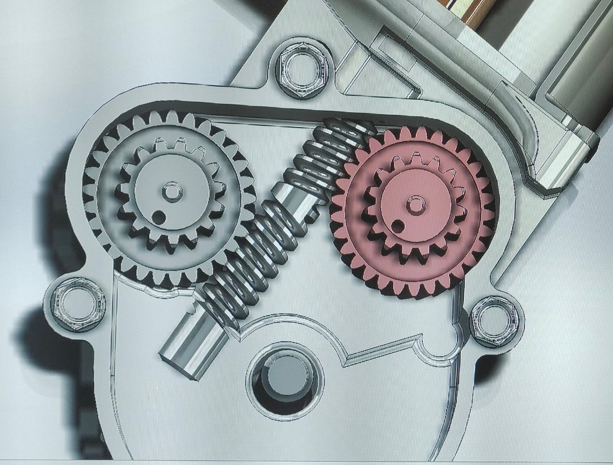
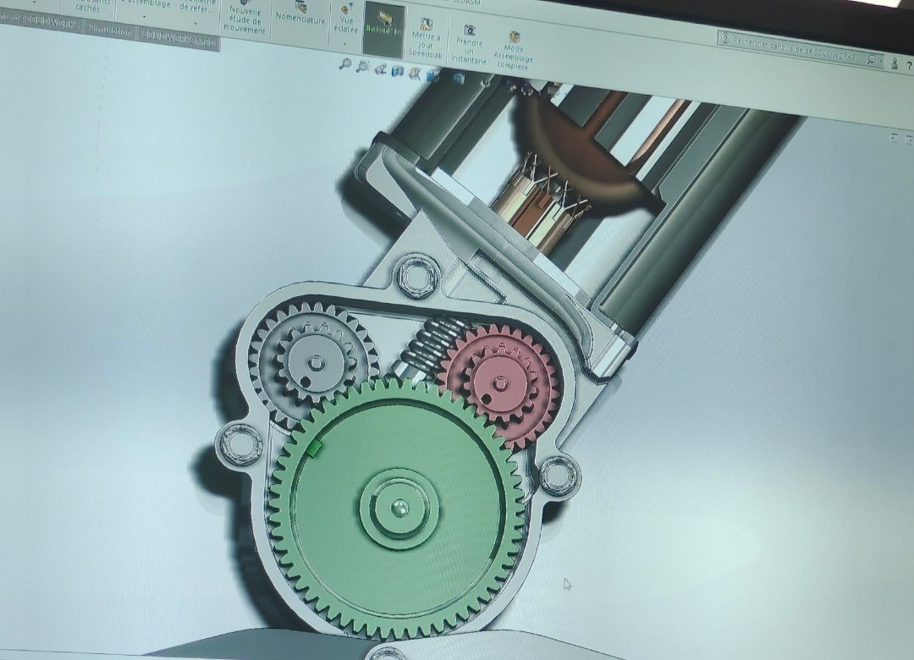
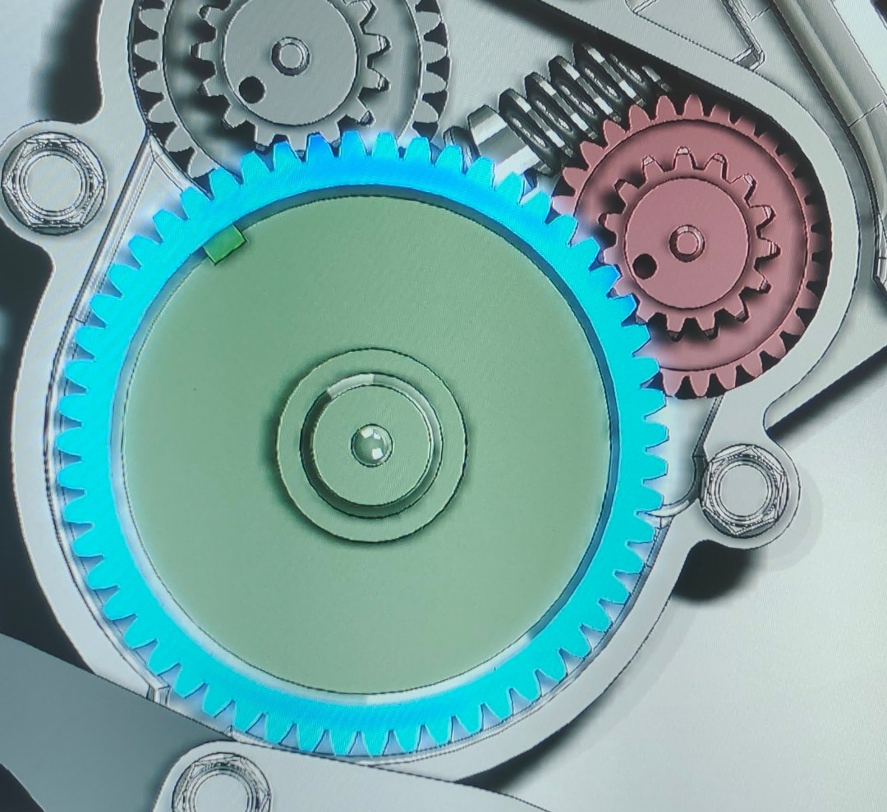

# Cordeuse de raquette : réducteur à vis sans fin et boucle d'effort

🇫🇷 [Français](#français) · 🇬🇧 [English](#english)

**Essayer la démo :** https://valentin-auger-laboratoire.github.io/portfolio/demos/cordeuse/

---

## Français

### Le TP
TP de sciences de l'ingénieur, **CPGE TSI, septembre 2024**, fait seul, sur une cordeuse de raquette asservie en effort.

**Chaîne d'énergie :** moteur à courant continu → vis sans fin → deux roues de 29 dents en parallèle → pignons de 15 dents → grande roue → pignon de chaîne → chaîne → poussoir → ressort calibré → chariot → corde.

**Chaîne d'information :** un potentiomètre mesure l'écrasement λ du ressort, ce qui donne la tension T = K_r·λ. La carte compare cette tension à la consigne et commande le moteur par un hacheur.

### Ma modification
La maquette numérique SolidWorks du moto-réducteur est fournie avec le banc. J'ai repris la **grande roue** : j'ai revu son nombre de dents pour que le rapport de réduction donne le couple voulu. Le fichier modifié n'a pas été conservé. Il reste les photos de mon écran :

| Le réducteur | L'assemblage | La grande roue reprise |
|---|---|---|
|  |  |  |

La grande roue a **environ 60 dents**, comptées sur la photo : 10 pas sur un secteur de 60°. Les autres nombres de dents (29 et 15) sont donnés par le banc. Rapport de réduction :
- **avec une vis à 1 filet :** N = (29 / 1) × (60 / 15) = **116** ;
- **avec une vis à 2 filets,** il serait moitié moindre.

Le sujet du TP n'est pas publié.

### La démo (`demo/`)
- **Réducteur animé :** une vis à 1 ou 2 filets, les deux étages identiques et la grande roue de Z dents.
- **Vis sans fin :**
  - angle d'hélice γ et angle de frottement φ ;
  - rendement tan γ / tan(γ + φ) ;
  - **irréversible si γ ≤ φ :** la corde reste tendue moteur coupé (vis à 1 filet). Avec 2 filets, elle se détend.
- **Compromis selon le nombre de dents :** effort tenu au courant nominal contre vitesse de chaîne. Leur produit reste constant. Avec une roue de 30 dents, le moteur ne tient plus 250 N sans dépasser son courant nominal : c'est pour cela qu'il fallait revoir la roue.
- **Boucle d'effort simulée** (pas de 0,1 ms) :
  - correcteur proportionnel, saturation à ±12 V, mesure sur 10 bits ;
  - écart final e = T·a/(1 + a), avec a = r·R/(N·η·k·Kp), car la vis adhère dès que le couple moteur ne suffit plus ;
  - à l'arrêt, le correcteur proportionnel garde un courant Kp·e/R ;
  - scénarios : appui sur le bouton, coupure de courant, retour du chariot.

**Hypothèses** (valeurs non mesurées, réglables) :
- moteur 12 V, R = 0,8 Ω, k = 0,03 V·s/rad, courant nominal 4 A ;
- vis Ø 10 mm, module 0,8, frottement 0,1 ;
- pignon de chaîne Ø 30 mm ;
- ressort 10 N/mm, corde 2 N/mm ;
- potentiomètre 30 mm.

```bash
node demo/tests/test.js   # 70 tests
```

---

## English

### The lab
Engineering science lab, **CPGE TSI, September 2024**, done on my own, on a force-controlled racket stringing machine.
- **Energy chain:** a DC motor drives a worm, two 29-tooth wheels in parallel and their 15-tooth pinions, then the large wheel, the chain, a pusher and a calibrated spring. The spring pushes the carriage, which pulls the string.
- **Information chain:** a potentiometer measures the spring compression, giving the tension T = K_r·λ.

### My change
On the supplied SolidWorks model I reworked the **large wheel** (about 60 teeth, counted on my photo) so that the reduction ratio (116 with a single-start worm) gives enough torque. The file was not kept; photos of my screen are above. The lab sheet is not published.

### Demo (`demo/`)
- Animated gearbox.
- Worm efficiency and self-locking: with a single start the string stays tight when the power is cut.
- Force / speed trade-off versus tooth count.
- Simulated force loop with a proportional controller and its final error.
- 70 tests.
- Motor, spring, string and sprocket values are assumed and adjustable.

---

← [Portfolio](https://valentin-auger-laboratoire.github.io/portfolio/#projets)
